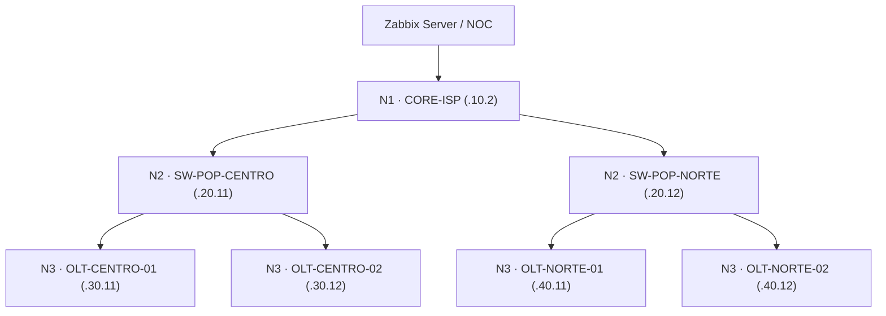

# 🎓 Guia do Aluno e Roteiro de Testes — Cascata de Alertas no Zabbix 7.0 (Aulas 01 e 02)

Este documento reúne o passo a passo completo das **duas aulas** para você usar como roteiro de gravação e disponibilizar aos alunos.

> 💡 **Apresentação em Slides Interativa:**
> Abra o arquivo [`apresentacao_aulas_01_e_02.html`](apresentacao_aulas_01_e_02.html) no navegador.
> - Use as setas **`◀` / `▶`** ou **`Espaço`** para passar os slides.
> - Pressione a tecla **`F`** para colocar em **Tela Cheia** durante a gravação.
> - Use os botões no topo para filtrar entre **Todas as Aulas**, **Foco Aula 01** ou **Foco Aula 02 (Templates)**.
> - Cada bloco de comando possui um botão **Copiar** com 1 clique.

---

## 🗺️ Topologia Comum às Duas Aulas



| Camada | Equipamento | Sufixo IP | Janela de Indisponibilidade | Pai (Dependência Topológica) |
|---|---|---|---:|---|
| **N1 · Core** | `CORE-ISP` | `.10.2` | **~10s (`#2`)** | — *(Raiz)* |
| **N2 · Distribuição** | `SW-POP-CENTRO` | `.20.11` | **~30s (`#6`)** | `CORE-ISP` |
| **N2 · Distribuição** | `SW-POP-NORTE` | `.20.12` | **~30s (`#6`)** | `CORE-ISP` |
| **N3 · Acesso** | `OLT-CENTRO-01` | `.30.11` | **~50s (`#10`)** | `SW-POP-CENTRO` |
| **N3 · Acesso** | `OLT-CENTRO-02` | `.30.12` | **~50s (`#10`)** | `SW-POP-CENTRO` |
| **N3 · Acesso** | `OLT-NORTE-01` | `.40.11` | **~50s (`#10`)** | `SW-POP-NORTE` |
| **N3 · Acesso** | `OLT-NORTE-02` | `.40.12` | **~50s (`#10`)** | `SW-POP-NORTE` |

---

# 🟢 AULA 01 — Fundamentos da Cascata e Dependência entre Hosts

- **Pasta:** `labs/cascata-alertas-zabbix/aula-01-fundamentos`
- **Zabbix Web (Aula 01):** <http://127.0.0.1:8188>
- **Página de Notificações (Aula 01):** <http://127.0.0.1:8189>
- **Mapa (Aula 01):** <http://127.0.0.1:8188/zabbix.php?action=map.view&sysmapid=2>

### Passo 1 — Subir e Conferir o Ambiente da Aula 01

```bash
cd labs/cascata-alertas-zabbix/aula-01-fundamentos
bash lab.sh up
bash lab.sh credentials
bash lab.sh status
```

### Passo 2 — Teste 1: Mostrar a Cascata de Alertas (Sem Dependências)

```bash
bash lab.sh mode off
bash lab.sh fail core
```

* **O que explicar enquanto aguarda ~60s:**
  - Aos ~10s (`#2`), o `CORE-ISP` entra em *PROBLEM*.
  - Aos ~30s (`#6`), os dois switches (`SW-POP-CENTRO` e `SW-POP-NORTE`) entram em *PROBLEM*.
  - Aos ~50s (`#10`), as 4 OLTs entram em *PROBLEM*.
* **Resultado na tela:** **7 problemas ativos no Zabbix e 7 notificações enviadas!**

### Passo 3 — Teste 2: Resolver a Cascata (Com Dependências)

```bash
bash lab.sh mode on
bash lab.sh fail core
```

* **O que explicar enquanto aguarda ~60s:**
  - O comando `mode on` recupera o Core, espera 10 coletas saudáveis, cadastra as 6 dependências e limpa as notificações.
  - Agora, quando o `core` para, aos ~10s o `CORE-ISP` entra em *PROBLEM*.
  - Quando os Switches POP (~30s) e as OLTs (~50s) fecham suas janelas de falha, o Zabbix verifica que o pai (`CORE-ISP`) já está em *PROBLEM* e suprime todos os alertas filhos.
* **Resultado na tela:** **1 único problema e 1 única notificação (`CORE-ISP: Equipamento inacessivel`)!**
* Rode `bash lab.sh status` para mostrar que `PING = 0` em todos os 7 hosts, mas `TRIGGER = OK` nos 6 filhos.

### Passo 4 — Teste 3: Queda Isolada do POP Centro

```bash
bash lab.sh restore
bash lab.sh clear
bash lab.sh fail pop-centro
```

* **Resultado após ~60s:** **1 única notificação (`SW-POP-CENTRO: Equipamento inacessivel`)**. As OLTs `OLT-CENTRO-01` e `02` ficam sem ping, mas são suprimidas; o POP Norte permanece 100% online.

### Passo 5 — Teste 4: Falha Simultânea Independente no POP Norte

Com o POP Centro ainda caído, derrube uma OLT do POP Norte:

```bash
bash lab.sh fail olt-norte-01
```

* **Resultado após ~55s:** chega uma **2ª notificação (`OLT-NORTE-01: Equipamento inacessivel`)**, provando que a dependência no ramo Centro não mascara falhas reais no ramo Norte.

Para encerrar a Aula 01:

```bash
bash lab.sh restore
bash lab.sh clear
```

---

# 🔵 AULA 02 — Arquitetura em Escala com Templates, Macros e Dupla Dependência

- **Pasta:** `labs/cascata-alertas-zabbix/aula-02-templates`
- **Zabbix Web (Aula 02):** <http://127.0.0.1:8190>
- **Página de Notificações (Aula 02):** <http://127.0.0.1:8191>
- **Mapa (Aula 02):** <http://127.0.0.1:8190/zabbix.php?action=map.view&sysmapid=2>

### O que muda na arquitetura da Aula 02?

1. **Template Base Único de ICMP (`TPL - NOTO TI - Base ICMP ISP`):**
   - Concentra os **3 itens ICMP**: `icmpping`, `icmppingloss` (%) e `icmppingsec` (s).
   - Concentra as **3 triggers com Macros**:
     - `Equipamento inacessivel` → usa `{$ICMP.FALHAS}`
     - `Perda de pacotes alta (>{$ICMP.LOSS.WARN}%)` → usa `{$ICMP.PERDA.AMOSTRAS}` (`#2`, ~10s) e `max(...)<100`
     - `Latencia alta (>80ms)` → usa `{$ICMP.LATENCIA.AMOSTRAS}` (`#4`, ~20s)
   - Concentra a **Dependência Interna** (no mesmo equipamento):
     - `Latencia alta` depende de `Perda de pacotes alta` e de `Equipamento inacessivel`.
     - `Perda de pacotes alta` depende de `Equipamento inacessivel`.
2. **3 Templates de Papel/Camada (Herança / *Linked Templates*):**
   - `TPL - NOTO TI - N1 Core` → herda o Base e define `{$ICMP.FALHAS} = #2` (~10s).
   - `TPL - NOTO TI - N2 Switch POP` → herda o Base e define `{$ICMP.FALHAS} = #6` (~30s).
   - `TPL - NOTO TI - N3 OLT` → herda o Base e define `{$ICMP.FALHAS} = #10` (~50s).
3. **Dependência Topológica Guiada por Tag (`uplink`):**
   - Nenhum item ou trigger é criado manualmente nos hosts.
   - Cada host possui a tag `uplink` (ex.: `uplink = CORE-ISP` ou `uplink = SW-POP-CENTRO`), usada pelo script para amarrar as triggers herdadas de indisponibilidade.

---

### Passo 1 — Subir e Mostrar a Árvore de Templates da Aula 02

```bash
cd labs/cascata-alertas-zabbix/aula-02-templates
bash lab.sh up
bash lab.sh credentials
bash lab.sh templates
bash lab.sh status
```

* **O que mostrar no Zabbix Web (`http://127.0.0.1:8190`):**
  1. **Data collection → Templates** (grupo `LAB - NOTO TI - Templates ISP`): mostre o `TPL - NOTO TI - Base ICMP ISP` e os 3 templates de camada.
  2. Abra `TPL - NOTO TI - N3 OLT` → aba **Linked templates** e aba **Macros** (`{$ICMP.FALHAS} = #10`).
  3. **Data collection → Hosts**: abra `OLT-CENTRO-01` → aba **Tags** (`uplink = SW-POP-CENTRO`) e mostre em **Triggers** as 3 triggers herdadas.

---

### Passo 2 — Teste A e B: Dependência INTERNA do Template (Degradação no Mesmo Host)

Simularemos um link degradado na `OLT-CENTRO-01` (**~50% de perda de pacotes + 150ms de latência ao mesmo tempo**, mantendo `PING = 1`):

#### Teste A — Sem Dependência Interna no Template (`internal off`):

```bash
bash lab.sh internal off
bash lab.sh degrade olt-centro-01
```

* Aguarde ~25 segundos e execute `bash lab.sh status`.
* **Resultado esperado:** a mesma `OLT-CENTRO-01` dispara **2 alertas** (`Perda de pacotes alta` **e** `Latencia alta`), poluindo o NOC com dois chamados para o mesmo defeito físico.

#### Teste B — Com Dependência Interna no Template (`internal on`):

```bash
bash lab.sh internal on
bash lab.sh degrade olt-centro-01
```

* Aguarde ~25 segundos e execute `bash lab.sh status`.
* **Resultado esperado:** embora `LOSS%` continue em `33%/67%` e `LAT(ms)` continue em `150.0 ms`, a `Perda de pacotes alta` abre aos ~10s (`#2`) e bloqueia a `Latencia alta` aos ~20s (`#4`). Chega **apenas 1 alerta (`OLT-CENTRO-01: Perda de pacotes alta (>20%)`)**!

#### Teste C — Apenas Latência Alta (0% de Perda):

```bash
bash lab.sh restore
bash lab.sh clear
bash lab.sh latency olt-centro-01
```

* Aguarde ~25 segundos e execute `bash lab.sh status`.
* **Resultado esperado:** como `LOSS% = 0%`, a trigger de perda não ativa e a trigger `Latencia alta (>80ms)` dispara normalmente (**1 alerta de latência**).

---

### Passo 3 — Teste D e E: Dependência TOPOLÓGICA entre Hosts com Templates

#### Teste D — Queda do Core SEM Dependência Topológica (`mode off`):

```bash
bash lab.sh mode off
bash lab.sh fail core
```

* Aguarde ~60 segundos.
* **Resultado esperado:** **7 problemas e 7 notificações** de `Equipamento inacessivel` (1 por equipamento).

#### Teste E — Queda do Core COM Dependência Topológica via Tag `uplink` (`mode on`):

```bash
bash lab.sh mode on
bash lab.sh fail core
```

* Aguarde ~60 segundos.
* **Resultado esperado:** **1 único problema e 1 única notificação (`CORE-ISP: Equipamento inacessivel`)**. As janelas `#2`, `#6` e `#10` definidas via Macro nos Templates de Camada funcionam em perfeita sincronia com a dependência topológica!

Para finalizar e deixar tudo limpo:

```bash
bash lab.sh restore
bash lab.sh clear
bash lab.sh status
```
