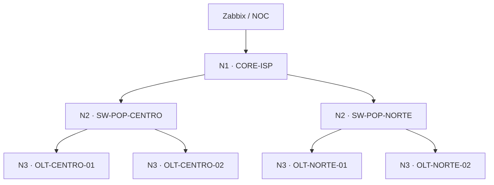

# NOTO TI · Laboratório ISP: cascata de alertas no Zabbix

Um core, dois POPs e quatro OLTs simuladas, com rede roteada e notificações enviadas por uma ação real do Zabbix. O laboratório começa com as dependências configuradas e permite mostrar o antes e depois no YouTube.

## Subir

Requisitos: Linux, Docker Engine com o plugin `docker compose`, Python 3.9 ou superior e acesso à internet para baixar as imagens. Reserve aproximadamente 4 GB de RAM livres. O Python utiliza somente a biblioteca padrão.

Extraia o ZIP, abra um terminal na pasta `nototi-cascata` e execute:

```bash
bash lab.sh up
```

Se seu usuário não tiver acesso ao daemon, execute o mesmo comando com `sudo`. O script não instala Docker nem altera configurações de um Zabbix existente.

O comando constrói os nós de rede, inicia o PostgreSQL, o Zabbix 7.0 e o receptor local, e cadastra os sete hosts, seus itens, triggers, dependências, mapa e ação. Aguarda dez coletas saudáveis antes de habilitar os alertas, para evitar problemas falsos na primeira inicialização.

Ao terminar, imprime os endereços, o usuário `Admin` e uma senha gerada para esta instalação. As credenciais ficam no `.env`, com permissão `600`.

Endereços preferenciais:

- Zabbix: <http://127.0.0.1:8188>
- Notificações: <http://127.0.0.1:8189>

Se as portas estiverem ocupadas, o script seleciona outras livres e imprime os endereços corretos. Para consultá-los depois:

```bash
bash lab.sh urls
bash lab.sh credentials
```

## Topologia



Os switches representam nós Linux com encaminhamento de camada 3, e as OLTs representam alvos ICMP. Este laboratório reproduz as dependências de conectividade; não emula firmware de OLT, GPON ou ONUs.

O Zabbix compartilha a rede do container `noc`. As consultas aos POPs e OLTs passam efetivamente pelo core e pelo switch correspondente. PostgreSQL, interface web e receptor de notificações ficam na rede de gerenciamento, fora dos trechos derrubados nos testes.

O prefixo é escolhido automaticamente entre redes privadas sem sobreposição detectada com as redes Docker e as rotas IPv4 do host. Exemplo com prefixo `10.231`:

| Equipamento | IP monitorado | Dependência da trigger |
|---|---|---|
| CORE-ISP | 10.231.10.2 | Nenhuma |
| SW-POP-CENTRO | 10.231.20.11 | CORE-ISP |
| SW-POP-NORTE | 10.231.20.12 | CORE-ISP |
| OLT-CENTRO-01 | 10.231.30.11 | SW-POP-CENTRO |
| OLT-CENTRO-02 | 10.231.30.12 | SW-POP-CENTRO |
| OLT-NORTE-01 | 10.231.40.11 | SW-POP-NORTE |
| OLT-NORTE-02 | 10.231.40.12 | SW-POP-NORTE |

Para escolher o prefixo antes da primeira inicialização:

```bash
LAB_NET_PREFIX=10.245 bash lab.sh up
```

Após a inicialização, preserve o prefixo e o arquivo `.env` para manter os IPs e as credenciais consistentes.

## Demonstração para gravar

Abra o Zabbix em **Monitoring → Problems**, o mapa criado em **Monitoring → Maps** e a página de notificações em outra aba. O grupo dos sete hosts é `LAB - NOTO TI - Cascata de alertas`.

### 1. Mostrar a cascata

```bash
bash lab.sh mode off
bash lab.sh fail core
```

O comando `mode off` recupera os equipamentos, aguarda a estabilização, remove as dependências e limpa a página de notificações. Depois da queda do core, aguarde aproximadamente 60–90 segundos. O resultado esperado é **sete problemas e sete notificações de problema**.

### 2. Repetir com dependências

```bash
bash lab.sh mode on
bash lab.sh fail core
```

O primeiro comando recupera e estabiliza os equipamentos, repõe as seis dependências e limpa a página. O resultado esperado da nova queda é **um problema e uma notificação: CORE-ISP inacessível**.

### 3. Derrubar apenas o POP Centro

```bash
bash lab.sh restore
bash lab.sh clear
bash lab.sh fail pop-centro
```

Resultado esperado: **uma notificação do SW-POP-CENTRO**. As OLTs do Centro ficam sem resposta, enquanto o POP Norte continua acessível.

### 4. Demonstrar uma falha independente no outro POP

Com o POP Centro ainda indisponível:

```bash
bash lab.sh fail olt-norte-01
```

Resultado esperado: **chega uma nova notificação da OLT-NORTE-01**. Uma dependência no Centro não bloqueia a falha independente no Norte.

Para terminar a gravação:

```bash
bash lab.sh restore
```

## Como as triggers funcionam

Todos os itens são do tipo Simple check, com chave `icmpping[,3,200,,500]`, intervalo de coleta de 5 segundos e valores `1` para resposta e `0` para falha.

| Nível | Expressão no host correspondente | Janela aproximada |
|---|---|---|
| Core | `max(/CORE-ISP/icmpping[,3,200,,500],#2)=0` | 10 segundos |
| Switch de POP | `max(/SW-POP-CENTRO/icmpping[,3,200,,500],#6)=0` | 30 segundos |
| OLT | `max(/OLT-CENTRO-01/icmpping[,3,200,,500],#10)=0` | 50 segundos |

Esses tempos foram escolhidos para o laboratório: o pai deve entrar em PROBLEM antes que a janela do filho se complete. Eles não são uma recomendação universal para produção. A carga de processamento pode acrescentar atraso.

As dependências são entre triggers e a verificação é recursiva. Não é necessário adicionar também o core diretamente em cada trigger de OLT.

A coleta ICMP continua mesmo com uma dependência ativa. Uma OLT pode ter ping `0` e a trigger permanecer em `OK` porque seu pai está em `PROBLEM`. Esse `OK` não comprova que a OLT esteja acessível. Use **Latest data** ou `bash lab.sh status` para mostrar a diferença entre o dado coletado e o estado da trigger. A notificação do pai indica perda de acesso a partir do NOC, não comprova que o equipamento esteja desligado.

As janelas de recuperação também dependem de novas coletas. Aguarde a conclusão de `restore` ou `mode` antes de iniciar o próximo teste. Adicionar uma dependência não desfaz mensagens já enviadas.

## Notificações

O Zabbix envia o webhook para um receptor no próprio laboratório. A página exibe o nome do equipamento, ID do evento, horário de recebimento, problemas e recuperações. Os contadores refletem as mensagens recebidas desde a última limpeza; não são contadores de problemas atualmente ativos.

A ação utiliza somente o grupo do laboratório e envia uma mensagem inicial e outra de recuperação. O receptor não descarta mensagens repetidas, permitindo detectar duplicações no teste. A página atualiza a cada dois segundos.

## Teste automático na sua máquina

Depois de subir:

```bash
bash lab.sh test
```

O teste controla os containers e confere ping, estados das triggers e mensagens recebidas nestes cinco cenários:

| Cenário | Hosts inacessíveis | Notificações de problema esperadas |
|---|---:|---:|
| Core, sem dependências | 7 | 7 |
| Core, com dependências | 7 | 1 |
| POP Centro | 3 | 1 |
| OLT Centro 01 | 1 | 1 |
| POP Centro e OLT Norte 01 | 4 | 2 |

O teste dura vários minutos porque aguarda as coletas reais do Zabbix. Ele recupera os equipamentos e repõe o modo anterior no encerramento. O relatório é salvo em `test-report.json`. Se for interrompido ou se a recuperação falhar, execute `bash lab.sh restore`.

O arquivo `VALIDACAO.md` descreve as verificações feitas no ambiente de preparação. A execução com Docker precisa ocorrer no host de destino.

## Comandos

| Comando | Efeito |
|---|---|
| `bash lab.sh up` | Inicia e configura o laboratório; pode ser executado novamente |
| `bash lab.sh mode off` | Recupera tudo e prepara o cenário sem dependências |
| `bash lab.sh mode on` | Recupera tudo e prepara o cenário com dependências |
| `bash lab.sh fail core` | Para somente o core |
| `bash lab.sh fail pop-centro` | Para somente o switch do POP Centro |
| `bash lab.sh fail olt-centro-01` | Para somente a OLT selecionada |
| `bash lab.sh recover core` | Reinicia o equipamento selecionado |
| `bash lab.sh restore` | Recupera todos os equipamentos e aguarda estabilização |
| `bash lab.sh status` | Mostra último ping, estado da trigger e dependência |
| `bash lab.sh ping` | Testa o alcance dos sete IPs a partir do NOC |
| `bash lab.sh clear` | Limpa a página de notificações |
| `bash lab.sh test` | Executa os cinco cenários de teste |
| `bash lab.sh logs` | Mostra os logs recentes para diagnóstico |
| `bash lab.sh stop` | Para os containers e preserva os dados |
| `bash lab.sh down` | Remove os containers e redes do projeto; preserva volumes e credenciais |

Os equipamentos aceitos em `fail` e `recover` são: `core`, `pop-centro`, `pop-norte`, `olt-centro-01`, `olt-centro-02`, `olt-norte-01` e `olt-norte-02`.

As portas web são publicadas somente em `127.0.0.1`. Se o Docker estiver em outro Linux acessado por SSH, você pode abrir um túnel para as portas impressas pelo script.

## Referências oficiais

- [Dependências de triggers no Zabbix 7.0](https://www.zabbix.com/documentation/7.0/en/manual/config/triggers/dependencies)
- [ICMP e Simple checks](https://www.zabbix.com/documentation/7.0/en/manual/config/items/itemtypes/simple_checks)
- [Zabbix em containers](https://www.zabbix.com/documentation/7.0/en/manual/installation/containers)
- [Redes no Docker Compose](https://docs.docker.com/compose/how-tos/networking/)
