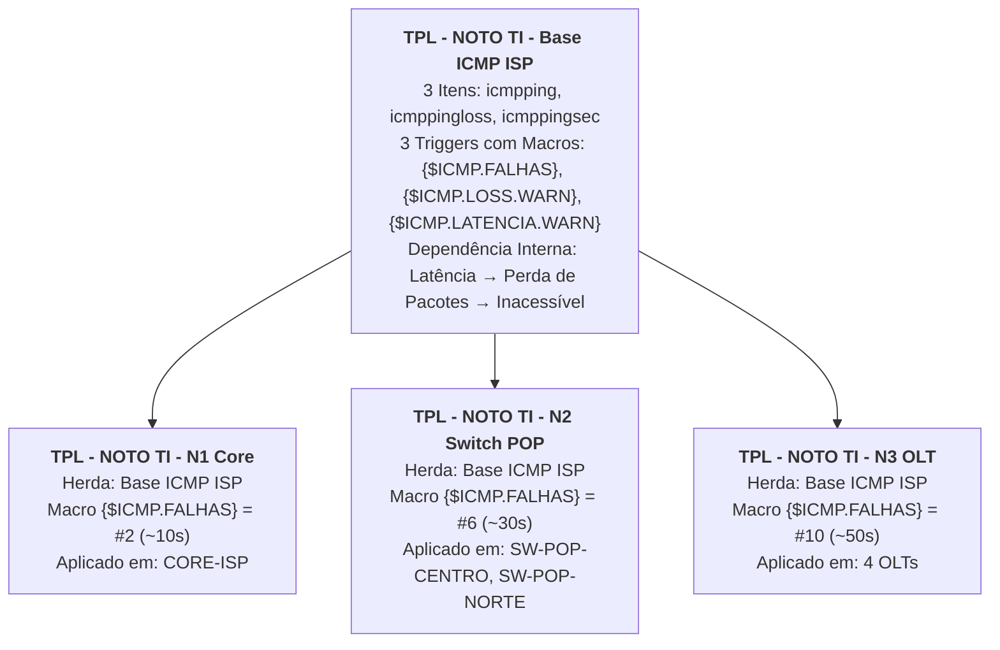

# NOTO TI · Aula 02: Templates, Herança, Macros e Dependências no Zabbix

Evolução direta da Aula 01: agora **nenhum item ou trigger é criado manualmente nos hosts**. Toda a inteligência de monitoramento ICMP vem de uma arquitetura profissional de **Templates com Herança (Linked Templates)**, **Macros por Camada (N1/N2/N3)**, **Dependências Internas (no Template)** e **Dependências Topológicas (nos Hosts via Tag `uplink`)**.

> **Convivência com a Aula 01:** este projeto usa o nome `nototi-cascata-aula02`, portas preferenciais `8190` e `8191` e outra faixa de rede privada (`10.232.x.0/24`), podendo rodar simultaneamente com a Aula 01 sem conflito.

---

## Subir o Laboratório da Aula 02

Abra um terminal na pasta `nototi-cascata-aula02` e execute:

```bash
bash lab.sh up
```

Endereços preferenciais da Aula 02:

- **Zabbix (Aula 02):** <http://127.0.0.1:8190>
- **Notificações (Aula 02):** <http://127.0.0.1:8191>

Para consultar endereços, credenciais e a árvore de templates a qualquer momento:

```bash
bash lab.sh urls
bash lab.sh credentials
bash lab.sh templates
```

---

## Arquitetura de Templates no Zabbix (O que mostrar na Aula 02)

No menu **Data collection → Templates**, selecione o grupo `LAB - NOTO TI - Templates ISP`. Você verá **4 templates**:



### Por que essa separação é o padrão ouro em ISPs?

1. **Zero duplicação de itens ICMP:** os itens `icmpping`, `icmppingloss` e `icmppingsec` existem **apenas** no `TPL - NOTO TI - Base ICMP ISP`. Se você quiser mudar o intervalo de coleta de `5s` para `10s`, altera em um único lugar e todos os equipamentos herdam.
2. **Janela de tempo por camada sem mexer na expressão:** a trigger no Template Base usa `max(/.../icmpping[,3,200,,500],{$ICMP.FALHAS})=0`. Os templates `N1 Core`, `N2 Switch POP` e `N3 OLT` não têm itens próprios — eles apenas vinculam o Template Base e sobrescrevem a macro `{$ICMP.FALHAS}` para `#2`, `#6` e `#10`.
3. **Dois níveis de dependência trabalhando juntos:**
   - **Dependência Interna (dentro do `TPL - NOTO TI - Base ICMP ISP`):**
     - `Latencia alta (>80ms)` depende de `Perda de pacotes alta (>20%)` e `Equipamento inacessivel`.
     - `Perda de pacotes alta (>20%)` depende de `Equipamento inacessivel`.
   - **Dependência Externa / Topológica (nas triggers herdadas nos Hosts, guiada pela Tag `uplink`):**
     - Cada host possui a tag `uplink` (ex.: `uplink = CORE-ISP` ou `uplink = SW-POP-CENTRO`).
     - A trigger herdada `Equipamento inacessivel` do filho depende da trigger herdada `Equipamento inacessivel` do pai.

---

## Roteiro de Demonstração para Gravação (Aula 02)

### Parte 1 — Mostrar os Templates no Zabbix e no Terminal

```bash
bash lab.sh templates
```

No Zabbix Web:
1. Vá em **Data collection → Templates** e mostre o `TPL - NOTO TI - Base ICMP ISP` (os 3 itens, as 3 triggers com macros e as dependências internas entre elas).
2. Abra `TPL - NOTO TI - N1 Core`, `N2 Switch POP` e `N3 OLT` → aba **Linked templates** e aba **Macros** (`{$ICMP.FALHAS}` = `2`, `6` e `10`).
3. Vá em **Data collection → Hosts**, abra `OLT-CENTRO-01` → mostre a aba **Tags** (`uplink = SW-POP-CENTRO`) e mostre em **Triggers** que todas as 3 triggers são herdadas do template, mas a trigger `Equipamento inacessivel` tem a dependência apontando para `SW-POP-CENTRO`.

---

### Parte 2 — Demonstrar a Dependência INTERNA do Template (Mesmo Equipamento)

Quando um link degrada (sobe a latência para ~150ms **e** perde ~50% dos pacotes ao mesmo tempo, mas sem cair 100%):

#### 2.1. Sem dependência interna no Template (`internal off`):
```bash
bash lab.sh internal off
bash lab.sh degrade olt-centro-01
```
Aguarde ~20 segundos.
**Resultado esperado:** chegam **2 notificações da mesma OLT** (`Perda de pacotes alta` **e** `Latencia alta`), gerando ruído duplicado do mesmo problema físico.

#### 2.2. Com dependência interna no Template (`internal on`):
```bash
bash lab.sh internal on
bash lab.sh degrade olt-centro-01
```
Aguarde ~20 segundos.
**Resultado esperado:** chega **apenas 1 notificação** (`OLT-CENTRO-01: Perda de pacotes alta (>20%)`). A trigger de `Latencia alta` fica suprimida pela dependência interna do Template Base!

#### 2.3. Apenas latência alta (sem perda de pacotes):
```bash
bash lab.sh restore
bash lab.sh clear
bash lab.sh latency olt-centro-01
```
Aguarde ~20 segundos.
**Resultado esperado:** como não há perda de pacotes, a trigger de `Latencia alta (>80ms)` não é bloqueada e dispara normalmente (**1 notificação de latência alta**).

---

### Parte 3 — Demonstrar a Dependência TOPOLÓGICA entre Hosts (Cascata Core → POP → OLT)

#### 3.1. Queda do Core SEM dependências topológicas (`mode off`):
```bash
bash lab.sh mode off
bash lab.sh fail core
```
Aguarde ~60–90 segundos.
**Resultado esperado:** **7 problemas e 7 notificações** (todas as 3 camadas apitam `Equipamento inacessivel`).

#### 3.2. Queda do Core COM dependências topológicas via Tag `uplink` (`mode on`):
```bash
bash lab.sh mode on
bash lab.sh fail core
```
Aguarde ~60–90 segundos.
**Resultado esperado:** **1 problema e 1 notificação (`CORE-ISP: Equipamento inacessivel`)**. As macros `{$ICMP.FALHAS}` dos templates (`2`, `6`, `10`) garantem que o Core entre em problema aos ~10s, bloqueando os Switches POP (~30s) e as OLTs (~50s).

#### 3.3. Recuperar tudo:
```bash
bash lab.sh restore
bash lab.sh clear
```

---

## Resumo de Todos os Comandos (`lab.sh`)

| Comando | Efeito |
|---|---|
| `bash lab.sh up` | Sobe containers, cria os 4 templates, 7 hosts, mapa, ação e valida coletas |
| `bash lab.sh templates` | Exibe a hierarquia dos templates, macros `{$ICMP.FALHAS}` e tags `uplink` |
| `bash lab.sh status` | Mostra PING, LOSS%, LAT(ms), triggers ativas, template e dependência |
| `bash lab.sh mode off` | Recupera tudo e remove as dependências topológicas entre hosts |
| `bash lab.sh mode on` | Recupera tudo e recria as dependências topológicas lendo a tag `uplink` |
| `bash lab.sh internal off` | Recupera tudo e remove as dependências internas do Template Base |
| `bash lab.sh internal on` | Recupera tudo e restaura as dependências internas no Template Base |
| `bash lab.sh degrade <equip>` | Simula link degradado (~50% perda + 150ms latência) no equipamento |
| `bash lab.sh latency <equip>` | Simula apenas latência alta (150ms, 0% perda) no equipamento |
| `bash lab.sh fail <equip>` | Derruba (para) o equipamento selecionado |
| `bash lab.sh recover <equip>` | Inicia o equipamento e limpa qualquer degradação de rede |
| `bash lab.sh restore` | Recupera todos os equipamentos, limpa degradações e aguarda estabilização |
| `bash lab.sh clear` | Limpa a página de notificações |
| `bash lab.sh ping` | Testa conectividade a partir do NOC |
| `bash lab.sh test` | Executa a bateria automatizada de 5 cenários de ponta a ponta |
| `bash lab.sh urls` | Mostra as URLs do Zabbix, Notificações e Mapa |
| `bash lab.sh credentials` | Mostra usuário e senha do Zabbix |
| `bash lab.sh stop` / `down` | Para ou remove os containers preservando volumes e `.env` |
